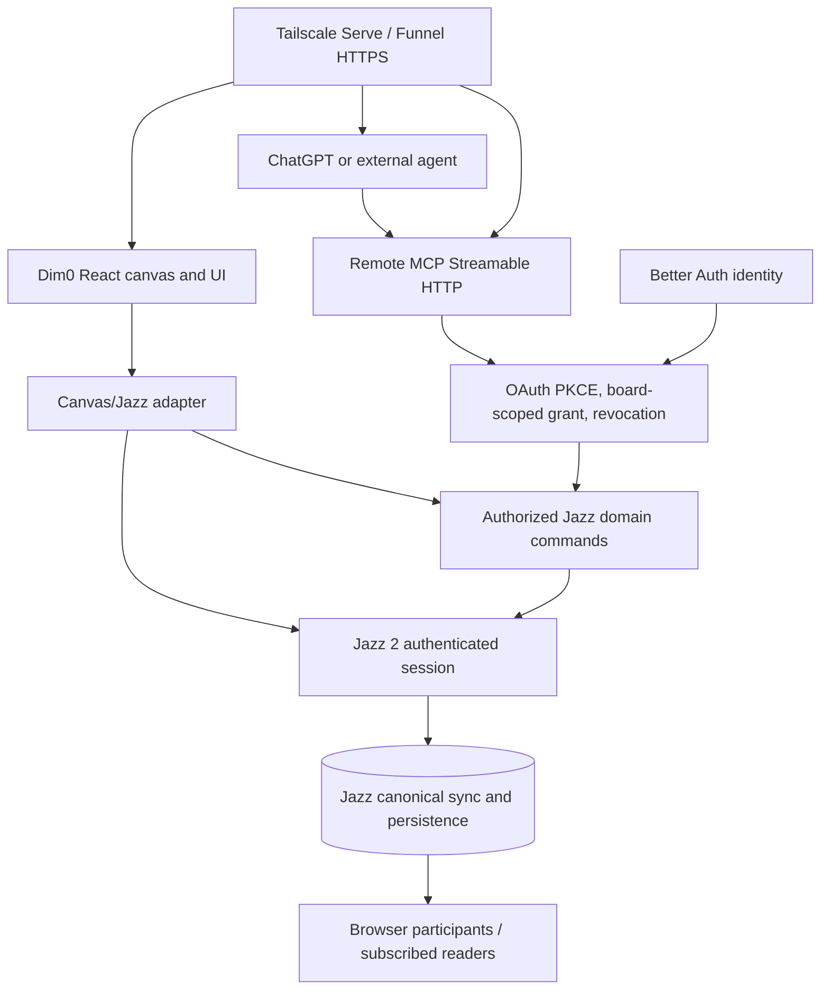

# Emergency migration: Patchboard → Dim0 fork

**Status (2026-11-21): In progress. This is NOT an end-to-end Jazz-powered Dim0 release.**

## Provenance and safety

| Item | Value |
|---|---|
| Upstream | [vcmf/dim0](https://github.com/vcmf/dim0), baseline `1bf00ba` |
| Fork | [drunkod/dim0](https://github.com/drunkod/dim0) |
| Local working branch | `feat/jazz-mcp-tailscale-migration` |
| Local path | `/Users/test/work/patchwork/dim0-jazz-port` |
| Patchboard main | `drunkod/agent-staff-board`, snapshot `5dad38a` |
| Patchboard source copy | `integrations/patchboard/` (tracked source only; no live data or secrets) |
| Existing services, data, worktrees | Do not modify, stop, overwrite, migrate in place, or replace Funnel mounts |

The fork's existing Dim0 Python backend **still uses PostgreSQL, Qdrant and Redis**. That code is upstream and is not magically migrated because the Patchboard source was copied. Until the CanvasStore + non-canvas domains are switched to Jazz and the old persistence paths are disabled, the full single-Jazz constraint is NOT satisfied.

## Hard acceptance criteria

1. Local browser experience and server remain runnable on the owner's MacBook, without any cloud application hosting.
2. Every board/domain write is made to **Jazz Tools 2**. No business-data SQL store, JSON-file source of truth, or secondary application DB.
3. **Both** normal users and external OAuth MCP agents use the same Jazz entity and permissions contract.
4. Full CRUD (including applets/code nodes, documents, folders, shapes, links) is authorized and visible in two subscribed clients without a page reload.
5. Tailscale Serve/Funnel routes expose only the intended authenticated app, Jazz WebSocket and OAuth MCP paths. Do not disturb existing mounts.
6. Existing private passkey, invitations, board roles, per-actor attribution, replay protection and authorization checks are preserved.
7. Start, reconnect, restart and rollback tests pass using **separate temporary data**, never production databases.

## Target architecture

**Authority boundaries:** the browser and MCP never pick their own `actorId`; the verified Better Auth subject is resolved to a Jazz account by the private server. Application data lives in Jazz. Better Auth currently uses a separate SQLite identity store; under the user's strict all-data-in-Jazz requirement, research and migrate that adapter as a separate explicit step, without breaking passkeys or OAuth grants.

## Priority roadmap (emergency sprint sequencing)

| Stage | Deliverable / file area | Gate | State | Estimate, 2 developers |
|---|---|---|---|---|
| P0.0 | Fork and isolated branch; current main snapshot; CodeGraph | Fork exists, no source data touched | **Done** | 0.5 day |
| P0.1 | Import Patchboard's Jazz 2, OAuth, HTTP/MCP server, policies and tests | Source present and unchanged except isolated port changes | **Done** | 0.5 day |
| P0.2 | Canonical `canvasEntities` table with append-only migration; transaction-safe CRUD | Create/update/delete, role and restart tests | **Implemented, isolated test passed** | 1–2 days |
| P0.3 | Add OAuth MCP canvas entity tools and same-origin REST adapter | End-to-end private OAuth MCP proof | **Implemented; isolated private OAuth/CRUD CI passed** | 1 day |
| P0.4 | Bind Dim0 CanvasStore hydration and user edit batches to Jazz | Two-user live edit/refresh including applets | **Opt-in hook + authenticated SSE implemented; two-client acceptance pending** | 3–6 days |
| P0.5 | Secure conflict and connection recovery in Jazz-driven canvas | Reconnect, collision, permissions, no lost edits | **CAS and fail-closed conflict handling added; durable offline outbox and rebase not done** | 2–4 days |
| P0.6 | Tailscale route on isolated local port and only selected HTTPS mount | Live WSS and remote MCP SDK access through Funnel | **Not deployed** | 1–2 days |
| P1.0 | Reconcile Dim0 auth, rooms, membership, invites and identity with Patchboard | Passkey/private/OAuth parity matrix green | **Not done** | 3–6 days |
| P1.1 | Migrate all remaining Dim0 business tables/metadata to Jazz | All domain entities mapped; no Postgres/Qdrant business writes | **Not done** | 8–15 days |
| P1.2 | Migrate searchable index, chats, applet state, uploads, revisions, automation | Search and file flows run with Jazz-backed data | **Not done** | 5–12 days |
| P1.3 | Migrate Better Auth database adapter to Jazz, if version supports required semantics | Passkey sessions/OAuth retained across reboot and revocation | **Research needed** | 3–8 days |
| P2.0 | Controlled import/export, dual-read audit (no dual-write), cutover and rollback | Data checksums, restart + backup/restore, parity report | **Not done** | 3–6 days |

The estimates overlap, are engineering planning ranges and assume the pre-existing Patchboard code is reused. A narrow Jazz+MCP+Dim0 visual demo could fit an aggressive **7–12 working days** with two developers; **full feature and database parity** is materially larger (roughly **5–10 weeks** with two developers, depending on backlog and integration findings). Never imply a complete port in one sprint without demonstrated acceptance.

## Working slices

**Implemented now (code, not live deployment):**
- `integrations/patchboard/packages/jazz-schema/schema.ts`: new indexed `canvasEntities` Jazz table with JSON payload, kind, revision and trusted updater.
- `integrations/patchboard/packages/jazz-schema/migrations/*dim0-canvas-entities*`: additive migration preserving existing Jazz history.
- `integrations/patchboard/apps/server/src/canvas-entity-service.ts`: explicit board permission checks inside serializable create/update/delete transactions, expected version check and global wait.
- `integrations/patchboard/apps/server/src/private-mcp.ts`: OAuth scope-gated list/get/create/update/delete canvas tools.
- `integrations/patchboard/apps/server/src/private-board-routes.ts`: authorized same-origin canvas API with no-store responses.
- `webui/src/features/board/jazz/jazz-canvas-api.ts`: **unmounted frontend transport adapter**, preserving complete Dim0 note/link JSON.
- Jazz and transport unit tests; complete CI and end-to-end gates must be checked below.

**Current development wiring:** `webui/src/features/board/harness/canvas/harness-canvas.tsx` can opt into the Jazz hook with `VITE_DIM0_JAZZ_CANVAS=1`, bypassing both old sync hooks. `integrations/patchboard/apps/server/src/private-canvas-stream.ts` streams actual Jazz live-query snapshots via authenticated SSE, and local canvas edits use versioned REST writes. This is NOT a completed migration: it lacks offline durable outbox, full board metadata/navigation/groups, non-canvas domains, multi-user Dim0 E2E, and Tailscale acceptance. Default behavior remains upstream Dim0.

## Definition of done: release gates

- `pnpm -C integrations/patchboard generate`, private policy drift check, TypeScript, lint, Jazz tests and private OAuth MCP proof.
- `node --test webui/src/features/board/jazz/jazz-canvas-api.test.mjs`.
- Dim0 frontend build, TypeScript and `vitest` after wiring the adapter.
- Multiple real browser profiles, one owner/editor/viewer/outsider, plus real external OAuth MCP account.
- From external agent, create an applet; both browsers immediately display it; editor edits it; agent patch retries and conflict detection work; after restart, the same entity IDs and contents remain.
- Verify every Jazz connection under private policy and that read-only MCP grants expose **no write tools**.
- Confirm the live Tailscale routes and TLS origin; request explicit deployment approval before replacing existing live paths.
- Backup Jazz + auth identities and test restore in an **isolated** directory before any cutover.

## Emergency operating rules

Never write to the running Patchboard store from a migration test. Never copy `.env`, secrets, database files or credentials. Do not change any existing Tailscale Serve/Funnel mount before the new isolated server passes the local suite. Avoid installing dependencies globally or altering legacy worktrees. Commit on this feature branch, open a draft PR and require acceptance before merging.
