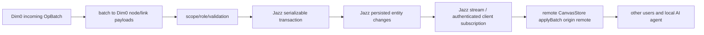

# CodeGraph navigation and domain-to-domain port map

This is an implementation map, not an assertion that all modules are already migrated. CodeGraph initial Dim0 index: 1,286 files, 17,047 symbols, 45,542 edges; after importing Patchboard it reached 1,341 files, 18,043 symbols, 47,503 edges.

## Getting around the code

```bash
cd /Users/test/work/patchwork/dim0-jazz-port
codegraph status .
codegraph sync .
codegraph explore useBoardSyncV2 --max-files 4
codegraph explore BoardPersistence --max-files 4
codegraph impact GraphStore
codegraph explore createCanvasEntity --max-files 4
codegraph callers getCanvasEntity
codegraph files
```

**Graph impact:** `codegraph impact GraphStore` found **310 affected symbols** (high-risk dependency boundary). Replacing `GraphStore` in-place would spread changes across agents, API, search and collaboration. Favor a narrowly gated Jazz data provider and port consumers incrementally; don't globally redirect `GraphStore` until each consumer has tests.

## Source-to-target map

| Patchboard canonical source | Dim0 target / extension point | Action |
|---|---|---|
| `integrations/patchboard/packages/jazz-schema/schema.ts` | `webui/src/features/board/types/note.ts`, `link.ts` | Preserve full node/link JSON in Jazz `canvasEntities` |
| `apps/server/src/board-service.ts` | `backend/topix/store/graph.py` | Replace business commands with Jazz services; no Python GraphStore writes |
| `apps/server/src/canvas-entity-service.ts` | `webui/src/features/board/harness/convert/{note-to-node,node-to-note,link-to-edge,edge-to-link}.ts` | Reuse converters; keep type semantics intact |
| `apps/web/src/main.ts` Jazz stream | `webui/src/features/board/harness/canvas/harness-canvas.tsx` | Add provider, hydrate and stream; bypass Dim0 v2 sync |
| `apps/server/src/private-auth/auth.ts` | `webui/src/features/signin/*`, `backend/topix/api/utils/auth_methods.py` | Decide identity authority; preserve passkey/OAuth sessions |
| `apps/server/src/private-mcp.ts` | `backend/topix/agents/*` and external ChatGPT | Maintain OAuth MCP and board-grant scope; add per-entity commands |
| `apps/server/src/private-board-routes.ts` | `webui/src/features/board/jazz/jazz-canvas-api.ts` | Same-origin authenticated read/write transport |
| `apps/server/src/http-server.ts` | `backend/topix/api/app.py` | Local service routing; avoid duplicate persisted business APIs |
| Jazz `boards` / `boardMembers` / `boardInvites` | `backend/topix/store/postgres/{graph,graph_user,graph_share_link}.py` | Translate and phase out PostgreSQL board metadata |
| Jazz `canvasEntities` | `backend/topix/store/qdrant/store.py` | Remove durable graph payload dependency; search indexes can be derived from Jazz |
| Jazz `agentRuns` / `proposals` | `webui/src/features/agent/*` | Store runs and audited proposals in Jazz; preserve approval semantics |
| Jazz `checkpoints`, later `revisionHistory` | `backend/topix/store/note_revision.py` | Port history and undo; do not drop snapshots |
| Jazz derived / indexed search | `webui/src/features/board/search/*` | Reuse local search projection, source all records from Jazz |
| Jazz applet and module-state tables (to design) | `webui/src/features/applet/*`, `mini-app/*` | Preserve applet source, state, versions, sandbox specs |
| Jazz content and blobs (to design) | `backend/topix/api/router/files.py` | Sync attachments through Jazz or a Jazz-managed durable blob reference |
| Jazz authenticated user, sessions (research) | `backend/topix/store/postgres/user.py` | Replace app metadata; preserve OAuth/policy, evaluate Better Auth Jazz adapter |
| Jazz chat transcripts and history (to design) | `backend/topix/store/postgres/chat_transcript.py` | Preserve agent conversation and revision provenance |

## Source code entry points

- **Dim0 canvas mount:** `webui/src/features/board/harness/canvas/harness-canvas.tsx` creates the `CanvasStore`, has agent bridge, node editing and both sync hooks.
- **Legacy collaboration:** `webui/src/features/board/harness/canvas/use-ws-collab.ts`.
- **v2 offline-first sync:** `webui/src/features/board/harness/canvas/use-board-sync-v2.ts` and `harness/sync/board-sync.ts`.
- **Current local persistence:** `webui/src/features/board/persist/local/board-persistence.ts` with IndexedDB/SQLite engines. Must not remain an independent business-data source for Jazz boards.
- **Dim0 data conversion:** `webui/src/features/board/harness/convert/*` should remain the one canonical node/edge adapter to `CanvasStore`.
- **Existing agent edits:** `webui/src/features/agent/engine/board-mutator.ts` and `webui/src/features/agent/engine/tools.ts`. Their changes must end up in Jazz, not only in a local store.
- **Existing backend agent:** `backend/topix/collab/agent_bridge.py`, `backend/topix/agents/notes/service.py`, `backend/topix/api/router/boards.py`. All require authority rework.
- **Existing P2 business stores:** `backend/topix/store/*` and `backend/topix/api/router/*`; inspect reachability before disabling.
- **Jazz schema / authorization:** `integrations/patchboard/packages/jazz-schema/schema.ts`, `private-permissions.ts` and compiled permissions JSON.
- **Trusted Jazz private OAuth path:** `integrations/patchboard/apps/server/src/private-mcp.ts` and `private-auth/grants.ts`.
- **Existing private Jazz transactions:** `integrations/patchboard/apps/server/src/board-service.ts`.
- **New Dim0 transaction commands:** `integrations/patchboard/apps/server/src/canvas-entity-service.ts`.

## Migration sequence (data-flow)



**Known complexities:** Dim0's `CanvasStore` changes are graph operations, while the new Jazz service stores entity snapshots with CAS versioning; avoid replacing whole applet source on every drag. Batch and coalesce property patches, guarantee link endpoint ordering, treat deletes and parent scopes correctly, use a durable pending outbox for offline edits only if Jazz's chosen client mode supports offline writes, and test identical updates from two agents. Do not run two independent synchronizers for one board.

## Dev-branch commands

```bash
cd integrations/patchboard
pnpm install --frozen-lockfile
pnpm generate
pnpm --filter @patchboard/jazz-schema generate:private:check
pnpm check
pnpm --filter @patchboard/server exec tsx --test test/canvas-entity.test.mjs
pnpm test:private:ci
cd ../..
node --test webui/src/features/board/jazz/jazz-canvas-api.test.mjs
```

All tests must operate against disposable Jazz stores and ephemeral ports. Do not infer success from a generated schema alone.
