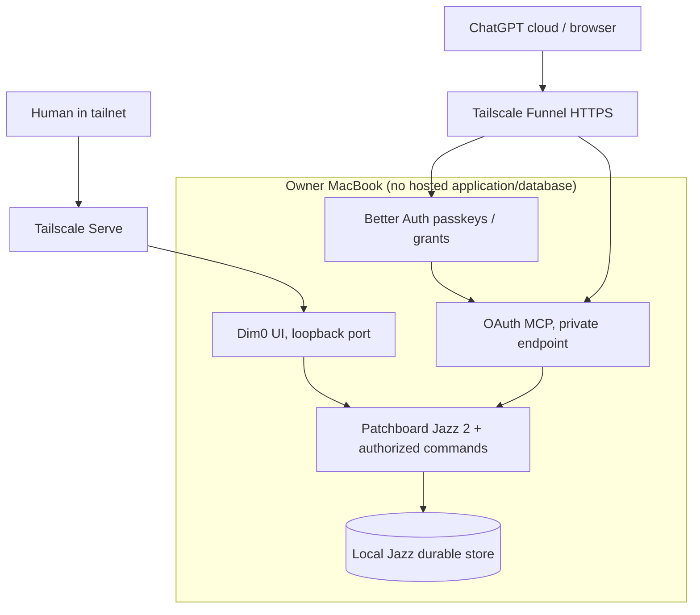

# Local-first operation and Tailscale/OAuth MCP release runbook

## Deployment architecture (required, NOT deployed in this branch)



The private board server currently binds `127.0.0.1`. Tailscale Serve/Funnel exposes selected paths; no second externally hosted app, VPS or managed database is required. ChatGPT generally needs a publicly reachable HTTPS MCP resource (Funnel) rather than a private MagicDNS endpoint. Public URL != anonymous access: all private MCP calls must pass OAuth resource-server authorization, grant scope and current Jazz membership.

## Never touch existing active endpoints while testing

Patchboard source already has documented production/demo routes in:
- `integrations/patchboard/docs/HUMAN_ACCEPTANCE_RUNBOOK.md`
- `integrations/patchboard/docs/ARCHITECT_LETTER_LOCAL_FIRST.md`
- `integrations/patchboard/docs/M2_PUBLIC_FUNNEL_RELEASE.md`

Read them first and check `tailscale serve status` and `tailscale funnel status` **read-only**. The old `/patchboard-private`, `/patchboard-private-mcp` and guest `/patchboard-mcp` must not be remapped casually. Do not modify `/orbit-mcp`.

Never commit `.env`, OAuth secrets, Jazz database files, Better Auth SQLite or production tokens. The imported archive contains only tracked source files.

## Local isolated verification

```bash
cd /Users/test/work/patchwork/dim0-jazz-port/integrations/patchboard
pnpm install --frozen-lockfile
pnpm generate
pnpm --filter @patchboard/jazz-schema generate:private:check
pnpm check
pnpm --filter @patchboard/server lint
pnpm --filter @patchboard/server exec tsx --test test/canvas-entity.test.mjs
pnpm test:private:ci
cd ../..
node --test webui/src/features/board/jazz/jazz-canvas-api.test.mjs
```

Tests generate temporary Jazz stores and ephemeral HTTP ports; they must not call the live profile data path. A successful return from the current private CI proves local OAuth tool exposure and private Patchboard sync, **not** a fully migrated Dim0 canvas or Tailscale remote network access.

## New MCP tools (private, OAuth-scoped)

| Tool | Scope | Operation | Protection |
|---|---|---|---|
| `list_canvas_entities` | `board:read` | Read up to 500 Jazz node/link entities | board grant + current membership |
| `get_canvas_entity` | `board:read` | Read one entity | board grant + current membership |
| `create_canvas_entity` | `board:write` | Create full Dim0 JSON node/link | server trust, board+type validation |
| `update_canvas_entity` | `board:write` | Update with `expected_version` | CAS, prevents stale write |
| `delete_canvas_entity` | `board:write` | Delete with `expected_version` | CAS, marked destructive |

Legacy `create_note`, `read_board`, `list_boards` remain for Patchboard compatibility. Both browser API and MCP route to the same Jazz domain commands.

### OAuth acceptance scenarios

1. Read-only token can discover read tools, never write tools.
2. `create_canvas_entity` on allowed board succeeds, then `get_canvas_entity` reads exact applet/JSX payload.
3. `update_canvas_entity(expected_version=1)` succeeds; repeating version 1 produces `VERSION_CONFLICT`.
4. Read or write to any other board (including boards owned by same human but outside OAuth grant) returns a permission failure.
5. Viewer/outsider/revoked editor cannot bypass current membership checks.
6. Delete uses destructive annotation and requires current version.
7. Existing passkey, session rotation, independent member login and two-browser Jazz sync remain intact.
8. With deployed **new** Tailscale paths, repeat the same actions via remote ChatGPT plugin (human acceptance required).

### Real deployment steps (not executed)

- Select a **new** unused local port, data directory and new isolated Tailscale path. Confirm no collision with existing services.
- Run the forked private Jazz server with an isolated test identity database, persistent Jazz path and explicit origins; test OAuth discovery and WSS on loopback first.
- Map only that isolated path via Tailscale Serve/Funnel and inspect the generated route mapping. Use a separate hostname/path if the live private server must coexist.
- Verify discovery `/.well-known/oauth-protected-resource`, `/.well-known/oauth-authorization-server`, PKCE, DCR, scopes and audience from an off-tailnet client.
- Connect an authorized real ChatGPT account and invoke read/write tools on a disposable board. Revoke the grant and confirm denial.
- Back up and restore the isolated Jazz store and auth store. Only then plan a live cutover, with explicit approval and rollback.

## Source compatibility and rollback

The original Patchboard worktrees/databases remain untouched. The Dim0 fork lives on an isolated branch and can be reset or removed without changing source projects. Data migration must be additive and checkpointed, not destructive; the new Jazz migration `canvasEntities` has a generated compatibility edge from historical schema `5658a06fb349` to `f32d81e25494`.

If a release gate fails, stop the new isolated server, leave old Tailscale mappings intact and revert the unmerged feature branch only. Never run cleanup commands against a production Jazz path.
