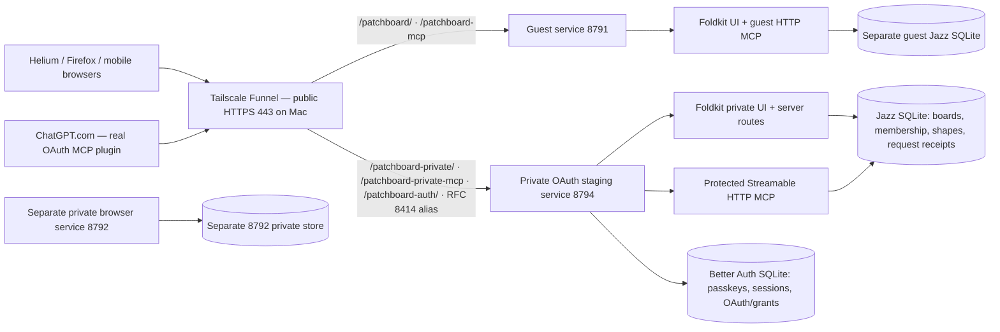
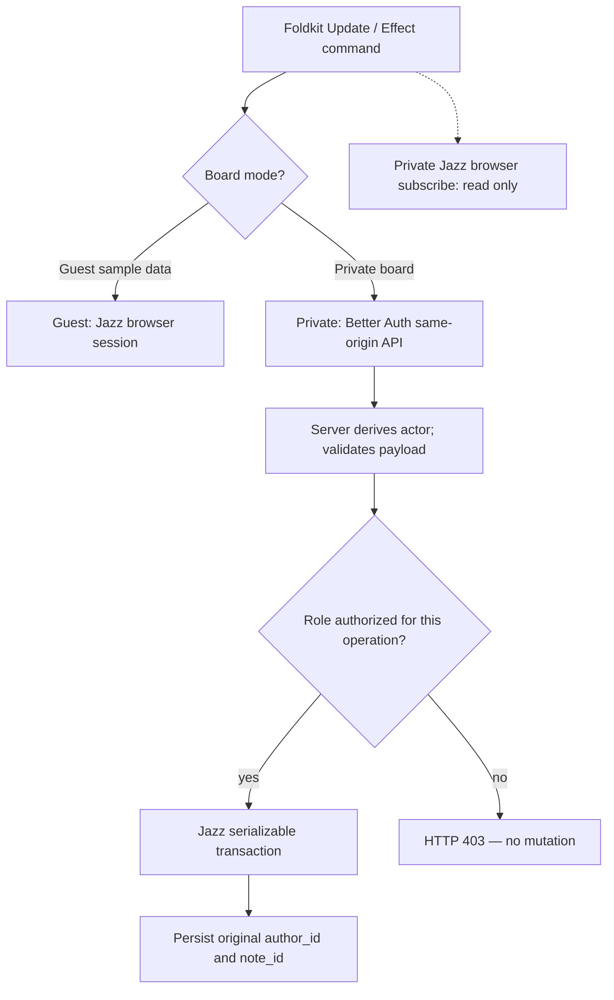
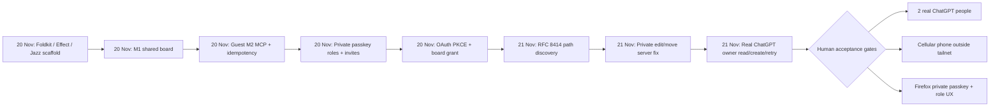

# Architecture diff — 19–21 November 2026 commits

**Source:** `drunkod/agent-staff-board`, merged `main` at `6f36a35`; checked 21 Nov 2026 (+05:00). **Scope:** Git history, current source code, CodeGraph symbols/call paths, tests, and the separate 19 Nov experimental starter. This is an implementation review, **not** an assertion of production security approval. For operator sign-off use [HUMAN_ACCEPTANCE_RUNBOOK.md](HUMAN_ACCEPTANCE_RUNBOOK.md).

## Date and repository boundaries

- **19 Nov (+05):** the *separate* `patchwork-board-mcp-starter` repo has commit `a6504c6`, “Scaffold Patchwork collaborative canvas MCP starter”. It uses Automerge/tldraw and a local stdio MCP bridge, read-only by default; it is **not** the remotely accessible Jazz/Better Auth Patchboard service. There are **no 19 Nov commits on the current `agent-staff-board/main` history**.
- **20 Nov (+05):** **24 non-merge commits** on Patchboard main, from `cca7a95` to `01fe126` in the date window. The implementation advanced from a scaffold through M1, local/HTTPS M2 guest MCP, private passkeys/collaboration, and OAuth PKCE with board-specific consent. Dates below use author timestamps; merge topology can differ from chronological author order.
- **21 Nov (+05):** implementation follow-ups include `943d40d` (two-writer proof), `efdff72` (RFC 8414 discovery alias), `9fa2f3e` (official SDK discovery regression), and `40e6c54` (authorized private edit/move). PRs **#2 → #3 → #4 → #5 → #6 → #7** merged in dependency order, culminating at `6f36a35`. These 21 Nov changes are listed separately so the “yesterday and day before” review does not silently misdate them.
- The MacBook has several *Git worktrees of the same repository* with older branches. **Do not add their commit counts together or mistake them for separate deployed codebases.** Architecture PR #1 remains open and is not merged into `main`.

## What the commits actually introduced

| Phase / commits | Code added or changed | Evidence and corresponding runbook correction |
| --- | --- | --- |
| **Scaffold and quality gates** `cca7a95`, `2f11b0d`, `fce6117`, `672f03a` | Foldkit Model/Message/update/view, Effect commands, Jazz schema, generated permissions, Story/Scene tests, CI and development contract | README and original roadmap still use the historical M1/M2 plan. Mark historical material explicitly. |
| **M1 shared Jazz board** `0175b2c`, `64a82f2`, `edaf050`, `3ff9e1f` | Node/Jazz SQLite runtime, browser board selection, create/edit/move, two-profile tests and reload/restart proof | M1 is **done**, not the current assignment. Its guest-mode browser writes differ from locked-down private mode. |
| **M2 guest MCP** `a172b3f`, `6d166cc`, `d4fa60a`, `7485f77`, `9778ba2`, `3b4b704`, `f4df0d4` | `read_board`, idempotent `create_note`, transactional `mcpRequests` receipt, one-process UI/Jazz/MCP demo, public Funnel SDK and WebSocket 101 proof | `8791` and `/patchboard-mcp` are **intentionally unauthenticated sample-data only**; SDK proof is not proof of an actual guest ChatGPT plugin grant. |
| **Private browser collaboration** `944bba9`, `fe53c70` | Better Auth/passkey identity (separate SQLite), server-side board creation/invites, memberships, Jazz read filters and private server `8792`; viewer/outsider isolation, three/four-profile proofs | The earlier “defer all OAuth/roles” section describes **only the historical guest plan**. Private browser writes must not call Jazz's denied direct update policy. |
| **Private remote OAuth MCP** `3e09adb`, `aca8125`, `01fe126` | RFC 9728 resource metadata, OAuth Authorization Code/PKCE/DCR/refresh, board-bound consent grant and scope enforcement; private `list_boards`, `read_board`, `create_note` and author-scoped idempotency | Protected `/patchboard-private-mcp` is distinct from guest `/patchboard-mcp`. Board selector is **not** supplied by ChatGPT as trust; its issued grant is bound on the server. |
| **Public discovery and independent authors** `943d40d`, `efdff72`, `9fa2f3e` | Tests for owner/editor with distinct author IDs, viewer denial and durable restart; exact path-based RFC 8414 alias for issuer `/patchboard-auth` so official SDK can start from only the MCP URL | OAuth discovery P1 is **closed**. The test's simulated OAuth clients are *not* a two-real-ChatGPT-account acceptance. |
| **Private edit/move fix** `40e6c54`, merged by PR #7 | `/patchboard-private/api/note/update`, `/note/move`, server-side role checks within Jazz serializable transaction; original note author retained, viewer denied | The red `Jazz update failed: authorization_denied` was caused by a UI wired to forbidden direct Jazz writes. Fix is merged, **without broadening Jazz private permissions**. |

Other docs-only milestones on 20 Nov include `218e85b` (MacBook/Funnel constraints), `b20a592` / `34a06f5` (local demo acceptance), and `93401bd` (handoff/bootstrap). The exact commit list can be reproduced with:

```sh
git log --no-merges --since='2026-11-19 00:00:00 +0500' --until='2026-11-21 00:00:00 +0500' --date=iso-local --format='%h %ad %s'
git log --no-merges --since='2026-11-21 00:00:00 +0500' --until='2026-11-22 00:00:00 +0500' --date=iso-local --format='%h %ad %s'
git diff --stat cca7a95..6f36a35
```

## Diagram A — current deployed topology



Logical boundaries are supported by `apps/server/src/demo.ts`, `private-demo.ts`, `private-auth/http.ts`, `private-mcp.ts`, `http-server.ts` and the documented Funnel mappings. The 8794 staging database is **not** production data. The live hostname also serves unrelated non-Patchboard apps; this diagram deliberately does not replace or enumerate their routing.

## Diagram B — ChatGPT OAuth authorization and one-board write

```mermaid
sequenceDiagram
    autonumber
    participant GPT as ChatGPT.com custom MCP plugin
    participant F as HTTPS Funnel
    participant A as Better Auth + OAuth grant DB
    participant B as Patchboard passkey/consent UI
    participant M as Private MCP handler
    participant J as Jazz backend SQLite
    participant W as Subscribed browser
    GPT->>F: Discover MCP endpoint (no token)
    F-->>GPT: 401 + resource metadata
    GPT->>F: RFC 9728 resource + RFC 8414 issuer metadata
    F-->>GPT: issuer /patchboard-auth, DCR/auth/token URLs
    GPT->>A: DCR + Authorization Code / PKCE S256
    A->>B: Sign in with passkey; choose one board
    B->>A: Consent: board:read, board:write, offline_access
    A-->>GPT: OAuth access token with board-grant claim
    GPT->>M: create_note(board_id, text, request_id) + Bearer
    M->>A: Check scope, subject, client and current board grant
    M->>J: Check current owner/editor membership
    M->>J: Atomic shape + actor-scoped idempotency receipt
    J-->>M: Persisted board_id, note_id
    M-->>GPT: Tool result (no arbitrary DB API)
    J-->>W: Jazz subscription / WebSocket update
```

**Important:** For the real ChatGPT connector, use **DCR with OIDC disabled**. ChatGPT's default OIDC enabled led to `invalid_scope` for unsupported `openid` and `email`. This is a connector **configuration discovery** from the November 21 real-browser test, not a change in OAuth code. The plugin was successfully connected with these scopes after disabling OIDC.

## Diagram C — private browser write versus guest direct Jazz write



Source: `apps/web/src/main.ts` (`CreateNote`, `UpdateNote`, `MoveNote`), `private-board-routes.ts`, `board-service.ts` (`changePrivateNote`, `createMcpNote`), `packages/jazz-schema/private-permissions.ts`. Private Jazz browser permissions deny **all** direct inserts, updates and deletes. The guest path is explicitly separate and cannot be used for private user data.

## Diagram D — commit dependency and acceptance sequence



Boxes summarize *features/dependencies*; they are **not** a claim that every historical commit was authored in exactly that sequence or that every branch was independently deployed.

## CodeGraph review — symbol and test coverage

Indexed on latest `main` in a clean worktree: **52 source files, 937 nodes, 1,761 edges** (38 TypeScript, 11 JavaScript, 3 YAML). The remaining tracked files include docs, lockfile, JSON, generated assets and migrations: the index is a semantic code view, **not a 98-file text diff**.

- `codegraph explore -p . --max-files 5 'private OAuth protected MCP client authorization passkey board scoped consent roles'`: surfaced `oauthConsentPage`, `executePrivateMcp`, `privateBoardRequest`, Better Auth config and the board-invite role types.
- `codegraph explore -p . --max-files 5 'private note update move create server transaction jazz policy authorship'`: surfaced Foldkit commands and their Story/Scene test dependencies.
- `codegraph explore -p . --max-files 5 'public MCP read_board create_note idempotency SQLite demo Jazz websocket'`: surfaced `createMcpNote` and the atomic receipt/membership check.
- `codegraph callers -p . executePrivateMcp`: `handlePrivateMcp` calls the tool handler.
- `codegraph affected -p . apps/server/src/private-mcp.ts apps/server/src/private-auth/http.ts apps/web/src/main.ts` reported only 2 UI test files. **Do not infer the private server has no tests:** its dynamic/HTTP entry points are outside static call-graph reach; manually map `apps/web/test/private-oauth-mcp-proof.mjs`, `apps/server/test/private-authz.test.mjs` and `apps/server/test/private-ci.mjs` as well.
- CI has **two distinct jobs**: `check` executes `pnpm verify`; `private-oauth` executes `pnpm test:private:ci`. Do **not** report a standalone `pnpm verify` as all private OAuth tests passing.

## Runbook drift uncovered

| Older documentation claim | Actual as of 21 Nov | Fix / remaining manual step |
| --- | --- | --- |
| README: “Planned remote MCP (not live yet)” | Guest MCP and protected private MCP are implemented; real owner ChatGPT OAuth read/create/retry passed | Update README to separate historical guest contract and active private capabilities |
| `M2_DEMO_START` lists previous branch as “current assignment” | PRs #2–#7 have merged | Mark section as historical; link to current operator runbook |
| `M2_PUBLIC_FUNNEL_RELEASE` says real ChatGPT is unverified | Still true **for the unauthenticated guest connector**; false if read as claiming *no Patchboard ChatGPT integration* | Keep guest report historical and explicitly distinguish real **private** ChatGPT success |
| `PRIVATE_OAUTH_PUBLIC_FUNNEL_QA` says “real ChatGPT connection unverified” | Real owner connection passed on 21 Nov with OIDC off | Add postscript, retaining its older SDK evidence |
| `ROADMAP` calls local MCP “NEXT” / private OAuth “pending” | M1/M2/private OAuth shipped to disposable staging | Put current status first; leave old milestone numbering as historical |
| Prior handoff lists two ChatGPT owner+editor accounts and external phone pending | **Still pending**; one real ChatGPT account does not satisfy either | Require H1/H2 before FULL GO; H3 for Firefox compatibility |
| “Jazz shared · connected” on background tab implies current canvas | Background tabs showed 3 notes and caught up to 4 only after foregrounding | Explicit active/background tests; investigate stale connection indicator |

## Recommended decision

**Conditional GO** for an explicitly labeled **single-account technical demo** using disposable test data. **No full two-person acceptance** until a second real ChatGPT account, cellular off-tailnet browser, two author IDs in open browsers, and controlled staging restart have been recorded. **No production or sensitive private-data launch** until revocation, DCR/rate limiting, recovery/restore and security review. The detailed order and evidence fields are in [the human runbook](HUMAN_ACCEPTANCE_RUNBOOK.md).

Reference links: [PR #2](https://github.com/drunkod/agent-staff-board/pull/2), [#3](https://github.com/drunkod/agent-staff-board/pull/3), [#4](https://github.com/drunkod/agent-staff-board/pull/4), [#5](https://github.com/drunkod/agent-staff-board/pull/5), [#6](https://github.com/drunkod/agent-staff-board/pull/6), [#7](https://github.com/drunkod/agent-staff-board/pull/7). Architecture-only [PR #1](https://github.com/drunkod/agent-staff-board/pull/1) remains a separate unmerged historical proposal.
